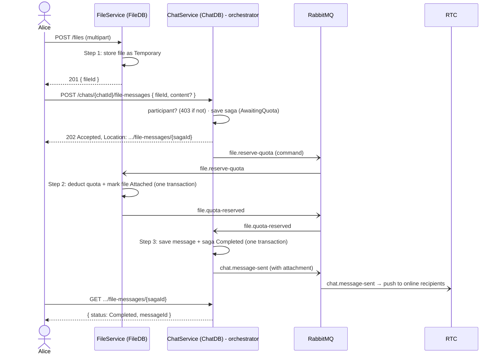

# Saga: a user sends a file that turns out to be too large (week 46)

Assignment: [`docs/weeks/uge-46-data-management-design-patterns.md`](../weeks/uge-46-data-management-design-patterns.md), scenario 2 ("A user sends a file that turns out to be too large").

A user attaches a file to a message in a chat. The file is stored by **FileService**, which also owns each user's **storage quota** (Standard: 20 MB, Premium: 1 GB - a Discord Nitro-like perk). The message is stored by **ChatService**. There is no transaction across the two databases, so the workflow is a **saga**: a sequence of local transactions where a later failure is undone by **compensating** transactions.

## The flow



### Failure paths

| What fails | Who notices | What happens | End state |
|---|---|---|---|
| Not a participant | ChatService, before the saga starts | 403. Nothing is started | (no saga) |
| **Quota exceeded** (the scenario) | FileService in step 2 | FileService deletes the temporary file **in the same local transaction** (compensating step 1) and answers `file.quota-rejected`. ChatService marks the saga Failed with the reason ("...Upgrade to Premium for more storage") | `Failed` |
| Message can't be saved in step 3 (the chat is gone, the sender is no longer a participant) | ChatService | Sends `file.release-quota`. FileService gives the quota back and deletes the file, then answers `file.quota-released` | `Compensating` → `Failed` |
| FileService (or a message) is gone - no answer within 2 minutes | ChatService's timeout job | Same compensation as above: `file.release-quota` | `Compensating` → `Failed` |
| A `file.quota-reserved` arrives **after** the timeout | ChatService | Sends `file.release-quota` again (idempotent). The message is never saved | stays `Failed` |
| `file.release-quota` gets no answer either | Timeout job | Retried up to 3 times in total, then the saga ends as `CompensationFailed` and an **Error** is logged for an operator | `CompensationFailed` |

The timeout path was tested end-to-end by stopping FileService mid-saga: the saga went to `Compensating`. When FileService came back, it processed the queued reserve **and** release, and the late `quota-reserved` triggered one more (no-op) release. The quota ended where it started.

## Steps (the assignment's template)

```
Step 1: Store the file temporarily                        (FileService)
  Started by:    POST /files (HTTP, before the saga is started)
  Success:       201 { fileId } - the file is Temporary, no quota used yet
  Failure:       400 (empty or over the 100 MB upload limit) - nothing to compensate
  Compensation:  Delete the temporary file
                 (done by FileService itself on quota-rejected, or by release-quota)

Step 2: Check and deduct quota                            (FileService)
  Started by:    file.reserve-quota      (command from the orchestrator)
  Success:       file.quota-reserved
  Failure:       file.quota-rejected     (file already deleted - saga ends, nothing more to compensate)
  Compensation:  file.release-quota → file.quota-released
                 (restore the quota, delete the file - triggered if step 3 fails or times out)

Step 3: Insert the message with the attachment            (ChatService, local)
  Started by:    file.quota-reserved
  Success:       message saved + saga Completed in one transaction → chat.message-sent
  Failure:       not allowed any more (chat gone, sender not a participant) → compensate step 2
  Compensation:  none needed - it is the last step, and it is only done if everything before it succeeded

Step 4: Channel activity / unread counters                (assignment step - not stored in our system)
  ChatService has no "last activity" or "unread" columns: they are derived from saved messages
  (receipts are created lazily when a message is seen/delivered). A message that was never saved
  leaves nothing to revert.
```

## Messages

Every message carries `sagaId` - that is how a reply is matched to its saga instance. The names are logical (`file.*`), and **FileService owns them**: the commands are addressed to it, the events come from it. Full wire format: [`apps/file-microservice/docs/contracts.md`](../../apps/file-microservice/docs/contracts.md).

| Name | Kind | From → To | Fields |
|---|---|---|---|
| `file.reserve-quota` | Command | ChatService → FileService | `sagaId`, `fileId`, `userId` |
| `file.quota-reserved` | Event | FileService → ChatService | `sagaId`, `fileId`, `userId`, `fileName`, `contentType`, `sizeBytes` |
| `file.quota-rejected` | Event | FileService → ChatService | `sagaId`, `fileId`, `userId`, `reason` |
| `file.release-quota` | Command (compensation) | ChatService → FileService | `sagaId`, `fileId`, `userId` |
| `file.quota-released` | Event | FileService → ChatService | `sagaId`, `fileId`, `userId` |

**Deviation from the assignment:** it says to define the messages in a shared `Shared.Contracts` project. We don't share code between services (see `CLAUDE.md` and ChatService's "Our answer to week 38, Task 02"), so each service has its own records and the contract is the documented JSON - tested from both sides (`FileSagaContractTests` in ChatService, `ContractTests` in FileService).

## Saga state

Lives in **ChatDB**, table `file_message_sagas` (domain class `FileMessageSaga`, repository `IFileMessageSagaRepository`):

`sagaId`, `chatId`, `senderUserId`, `fileId`, `content` (the text to send once the file is accepted), `status`, `messageId`, `failureReason`, `compensationAttempts`, `startedAt`, `updatedAt`.

```
AwaitingQuota ──quota-reserved + message saved──▶ Completed
      │
      ├──quota-rejected──▶ Failed
      │
      └──step 3 fails / timeout──▶ Compensating ──quota-released──▶ Failed
                                        │
                                        └──no answer after 3 attempts──▶ CompensationFailed
```

The status is used instead of the assignment's booleans (`PaymentProcessed`, `IsFailed`, ...): only a few combinations of booleans are valid, and a single status makes the invalid ones impossible.

**Concurrency:** a reply from FileService and the timeout job can handle the same saga at the same time. Every update is conditional on the status the saga had when it was loaded (`where status = @ExpectedStatus`), so only one of them wins. Step 3 saves the message and the saga update **in one local transaction**, so a message is never saved for a saga that the timeout job has already started compensating.

**Idempotency:** delivery is at-most-once, but duplicates are still possible (e.g. our own retries). FileService remembers which saga reserved a file (`files.saga_id`): a duplicate `reserve-quota` from the same saga answers `quota-reserved` again without deducting twice, and `release-quota` for something already released just answers `quota-released`.

## Why orchestration?

**ChatService orchestrates.** "Send a message" is ChatService's business transaction - FileService is a participant that answers yes or no to a command and knows nothing about the next step (`QuotaSagaParticipant`). The whole flow, including every compensation, can be read in one class: `FileMessageSagaOrchestrator`.

**What would be harder with choreography:**
- **Timeouts have no owner.** Our delivery is at-most-once - a lost `quota-reserved` would leave a saga hanging forever, and with choreography no service is responsible for noticing. The orchestrator has the state, so it can time out and compensate.
- **The flow would be implicit.** ChatService would react to "file accepted" events, FileService to "message failed" events, and nobody could point to where the workflow is defined. Adding a step (e.g. a virus scan) would mean changing several services' reactions instead of one orchestrator.
- With only two participants, the messages would be almost the same. The difference is who *knows* the flow - and that grows with every step.

**Where the state lives, and why there:** in ChatDB, because ChatService is the orchestrator and the one who has to answer the sender ("how did my file message go?"). The saga state and the message are in the same database, which is what makes step 3 one atomic local transaction.

## The hard question

> *If the message was already delivered to 200 online users before the quota check failed, what does compensation actually look like?*

**In our design that can't happen - on purpose.** The message is only saved (step 3) after the quota is reserved (step 2), and `chat.message-sent` is published only after step 3. The step nobody can undo - users *seeing* the message - is the **last** step (the pivot). Before it, every step can be compensated. The price is that the sender waits (202 Accepted + polling) instead of seeing the message instantly.

The alternative, an **optimistic** design, would show the message at once with an "uploading..." placeholder. If the quota check then failed, the compensation would be a `chat.message-retracted` event that clients use to replace the message with "This message was removed". But 200 users have already seen it, and maybe started downloading or replied to it. That compensation is a *semantic* undo (a new, visible fact), not a real rollback. We chose the pessimistic order because a rejected file should never reach other users.

## When a compensation is itself impossible

`file.release-quota` can be lost too. The timeout job retries it (3 attempts in total), and then gives up: the saga ends as `CompensationFailed`, and an **Error** is logged with `sagaId`, `fileId` and `userId` - an alert for an operator, who can release the quota by hand. We accept that in the meantime the user may have a few MB of quota "stuck". That is better than a saga that silently never ends.

## Known limitations

- A **temporary file that is never sent** (uploaded, then the user closes the app) is never deleted. A cleanup job in FileService should delete `Temporary` files older than, say, 24 hours.
- **Deleting a message later frees the quota** - but that is deliberately *not* part of the saga. `chat.message-deleted` carries `attachmentFileId`, and FileService deletes the file and gives the space back. A deletion can't be refused, so there is nothing to compensate: it is a plain event, not a command with a reply. If the event is lost (at-most-once), the space stays used. The quota is **storage** (what you have stored right now), not a rate per hour or day.
- **Downloads have no access check**: anyone with the (unguessable) file id can download. FileService doesn't know who is in which chat.
- **RTC pushes only the text** of `chat.message-sent`. Clients fetch the attachment via ChatService's REST API.
- The **file bytes live in Postgres** (`bytea`), so deleting the file and the quota change are one transaction. Real large files belong in blob storage.
- The gateway (in the teacher's repo) has no routes for FileService or `/file-messages` yet.
- The user's tier (Standard/Premium) would come from UserService. Today it is seed data in FileDB.

## Try it

```
docker compose up -d --build
```

| User | Id | Quota |
|---|---|---|
| Alice | `aaaaaaaa-aaaa-aaaa-aaaa-aaaaaaaaaaaa` | Premium, 1 GB |
| Charlie | `cccccccc-cccc-cccc-cccc-cccccccccccc` | Standard, 19 of 20 MB used → any file over 1 MB is rejected |

1. `POST http://localhost:8083/files` (multipart, field `file`, header `X-User-Id`) → `fileId`
2. `POST http://localhost:8081/chats/{chatId}/file-messages` `{ "fileId": "…", "content": "optional" }` → 202 + `sagaId` (Alice ↔ Charlie is chat `22222222-2222-2222-2222-222222222222`)
3. `GET http://localhost:8081/chats/{chatId}/file-messages/{sagaId}` → `Completed` (Alice) or `Failed` with the reason (Charlie)
4. `GET http://localhost:8083/quota` → used/remaining

To see the timeout: stop FileService (`docker compose stop fileservice`) between step 1 and 2, wait 2½ minutes, then start it again.

## Code

| What | Where |
|---|---|
| Orchestrator | `apps/chat-microservice/src/ChatService/Application/FileMessageSagaOrchestrator.cs` |
| Saga state (domain) | `apps/chat-microservice/src/ChatService/Domain/FileMessageSaga.cs` |
| Saga state (persistence) | `.../Infrastructure/Persistence/DapperFileMessageSagaRepository.cs`, `chatDB/postgres/init/004_file_message_saga.sql` |
| Replies → orchestrator | `.../Infrastructure/Messaging/FileSagaReplyConsumer.cs` |
| Timeout job | `.../Infrastructure/Messaging/FileSagaTimeoutService.cs` (`FileSaga:Timeout`, `FileSaga:CheckInterval`) |
| Participant | `apps/file-microservice/src/FileService/Application/QuotaSagaParticipant.cs` |
| Quota as one local transaction | `apps/file-microservice/src/FileService/Infrastructure/Persistence/DapperFileRepository.cs` |
| Tests | `ChatService.Tests`: `FileMessageSagaOrchestratorTests`, `FileMessageSagaTests`, `FileMessageSagaRepositoryTests`, `FileSagaContractTests`. `FileService.Tests`: `QuotaSagaParticipantTests` (incl. concurrent reservations), `ContractTests` |
